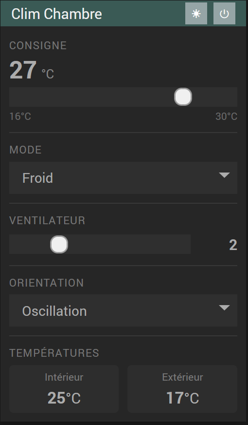

# Plugin Airwell

Plugin Jeedom pour le pilotage des climatiseurs Airwell via le protocole Gree (WiFi local, sans cloud).

## Prérequis

- Climatiseur Airwell équipé d'un module WiFi Gree
- Jeedom 4.4+
- PHP 8.0+
- Le climatiseur doit être sur le même réseau local que Jeedom

## Installation

Installer le plugin depuis le Market Jeedom, puis l'activer.

## Configuration d'un équipement

1. Aller dans **Plugins > Confort > Airwell**
2. Cliquer sur **Ajouter**
3. Renseigner l'adresse IP et MAC du climatiseur (tous les formats de MAC sont acceptés : `7C:B8:E6:25:1C:43`, `7c-b8-e6-25-1c-43`, `7cb8e6251c43`…)
4. Sauvegarder
5. Cliquer sur l'icône de binding pour établir la connexion

## Que faire si mes équipements ne sont pas trouvés ?

Si l'import automatique ne détecte aucun climatiseur, voici les vérifications à effectuer dans l'ordre :

### 1. Vérifier que le climatiseur est bien sur le même réseau Wi-Fi que Jeedom

Le protocole Gree fonctionne uniquement en **réseau local**. Le climatiseur et le Raspberry Pi (ou serveur Jeedom) doivent être sur le même sous-réseau (ex : `192.168.1.x`).

- Connectez le climatiseur au Wi-Fi via l'application Airwell ou Gree+.
- Vérifiez dans votre box/routeur que l'appareil apparaît bien dans la liste des équipements connectés.
- Si Jeedom est sur un VLAN séparé, le broadcast UDP ne passera pas — il faut que les deux équipements soient sur le même segment réseau.

### 2. Ajuster l'adresse IP de broadcast

Par défaut, le scan utilise `255.255.255.255`. Si votre réseau est segmenté, essayez l'adresse de broadcast de votre sous-réseau, par exemple `192.168.1.255`.

Dans la fenêtre d'import automatique, modifiez le champ IP avant de relancer le scan.

### 3. Vérifier que le module Wi-Fi du climatiseur est bien initialisé

Certains modules Wi-Fi Airwell/Gree nécessitent une première configuration via l'application officielle avant d'être détectables :

1. Téléchargez l'application **Gree+** ou **Airwell Connected**.
2. Ajoutez l'appareil dans l'application (procédure d'appairage Wi-Fi).
3. Une fois l'appareil visible dans l'application, relancez le scan depuis Jeedom.

### 4. Ajouter l'équipement manuellement

Si le scan ne fonctionne toujours pas, vous pouvez ajouter l'équipement à la main :

1. Relevez l'adresse IP et l'adresse MAC du climatiseur depuis votre box/routeur.
2. Cliquez sur **Ajouter** dans Jeedom.
3. Renseignez l'IP et la MAC, sauvegardez, puis cliquez sur l'icône de binding pour établir la connexion.

### 5. Diagnostiquer la connexion

Si le binding échoue (message `GreeProtocol: no response`), cliquez sur le bouton **Diagnostic** de l'équipement, à côté de l'icône de binding. Le plugin teste alors, à partir de l'IP et de la MAC enregistrées :

1. si le climatiseur est sur le même sous-réseau que Jeedom ;
2. si un appareil répond à cette IP (ping, puis table ARP pour vérifier qu'il a bien la MAC saisie) ;
3. si le climatiseur répond au protocole Gree quand on l'interroge directement ;
4. s'il est trouvé par le scan standard et par le broadcast de chaque réseau de Jeedom ;
5. si la clé obtenue lors du binding est acceptée.

Le rapport se termine par une conclusion qui indique la cause la plus probable et quoi faire. Si le climatiseur a changé d'IP, ou si la MAC saisie est fausse, un bouton permet de reporter la bonne valeur dans l'équipement. Il reste ensuite à sauvegarder et à relancer le binding.

Si vous demandez de l'aide, joignez le rapport : bouton **Copier le rapport**.

## Commandes disponibles

| Commande | Type | Description |
|---|---|---|
| Alimentation | Info binaire | État on/off |
| Mode | Info string | Mode actif (auto/cool/heat/dry/fan_only) |
| Température consigne | Info numérique | Température cible en °C |
| Vitesse ventilateur | Info numérique | Vitesse du ventilateur |
| Allumer | Action | Met en marche le climatiseur |
| Éteindre | Action | Arrête le climatiseur |
| Régler température | Action slider | Définit la température consigne (16-30°C) |
| Régler mode | Action select | Change le mode de fonctionnement |
